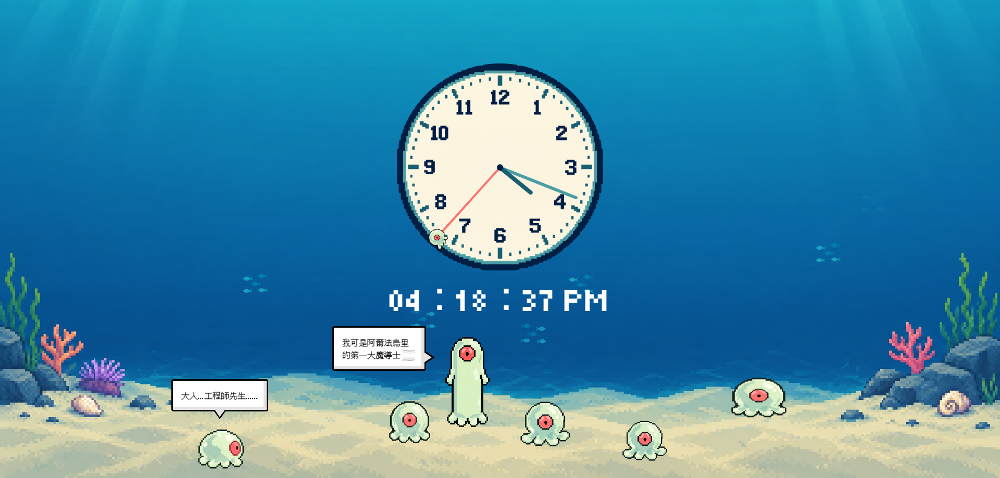

# Lemming 的海洋時鐘

一個以小說《이세계 착각 헌터》為主題的網頁時鐘，小說中的外星人主角 Lemming 會在畫面中隨機移動，也會與使用者互動，因為 Lemming 是水生生物，所以背景設定為海洋水族箱，且背景的顏色會隨時段改變，還有一群魚在海中悠游，可以像欣賞水族箱一樣，觀察 Lemming 在畫面中自由的活動。

## 功能

- **時鐘顯示**：數位時間與指針同步顯示時、分、秒。
- **隨機移動**：每 10 秒隨機挑選一隻閒置的 Lemming 移動，作用中的 Lemming 會有狀態標記，動作中的 Lemming 不會被選中。
- **點擊互動**
  - 點擊「跳躍型 Lemming」：播放跳躍動畫，為避免重複點擊，互動期間都會禁用點擊按鈕。
  - 點擊「伸長型 Lemming」：點擊後 Lemming 會伸長身體並彈出隨機小說語錄對話框 ( Lemming 的名字不是錯字，真的就長那樣 )。
  - 點擊「秒針上的小 Lemming」：會呼叫「跑動型 Lemming」跑過畫面，重複點擊「小 Lemming」會改變「跳動型 Lemming」的前進方向。
  - 點擊「跑動型 Lemming」：點擊後 Lemming 會彈出隨機對話框尋找工程師 ( 工程師的名字不是錯字，真的就長那樣 )。
- **午餐提醒**
  - 中午 12 點 Lemming 會操縱金技勵的身體出現並提醒吃午餐。
  - 點擊「午餐型 Lemming」：會彈出隨機對話框提出午餐建議選項 ( 因為金技勵是韓國人所以只有韓餐 )。
  - 出現時間為 12:00 ~ 12:30 之間，12:30 會準時離場。
- **時段色調**：依凌晨、白天、傍晚、夜晚切換海洋背景的濾鏡效果。
- **背景魚群**：隨機生成數條魚淡入淡出，並沿隨機路徑游動。

## 操作方式

| 操作                          | 結果                            |
| ----------------------------- | ------------------------------- |
| 點擊跳躍型 Lemming            | 重複進行多次跳躍                |
| 點擊伸長型 Lemming            | 伸長後出現小說語錄對話框        |
| 點擊秒針上的小 Lemming        | 跑動型 Lemming 從左或右越過畫面 |
| 點擊跑動型 Lemming            | 出現找工程師的對話框            |
| 點擊午餐型 Lemming            | 出現午餐建議的對話框            |
| 非互動狀態的 Lemming 隨機移動 | 無需操作                        |
